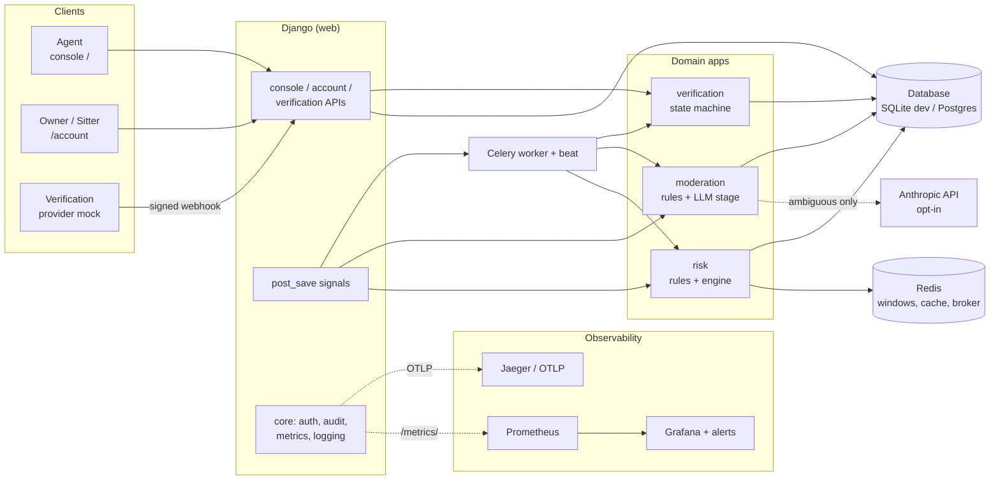
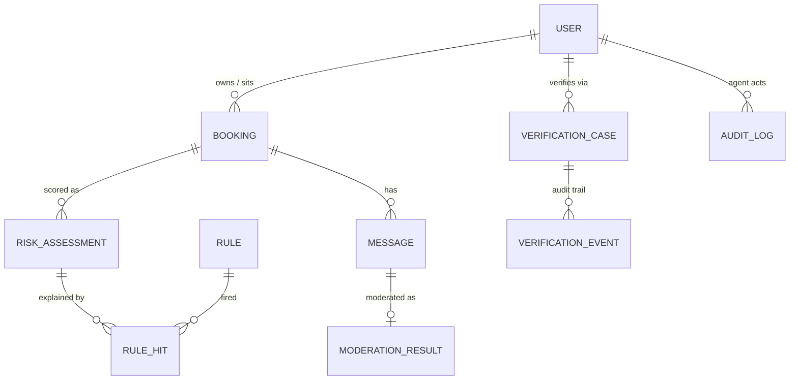
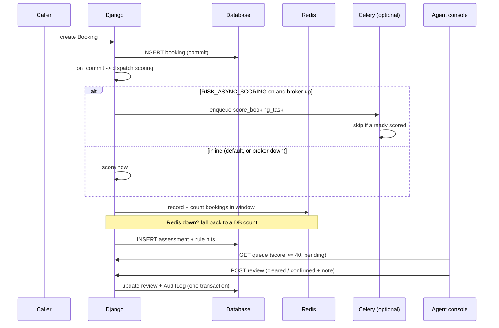
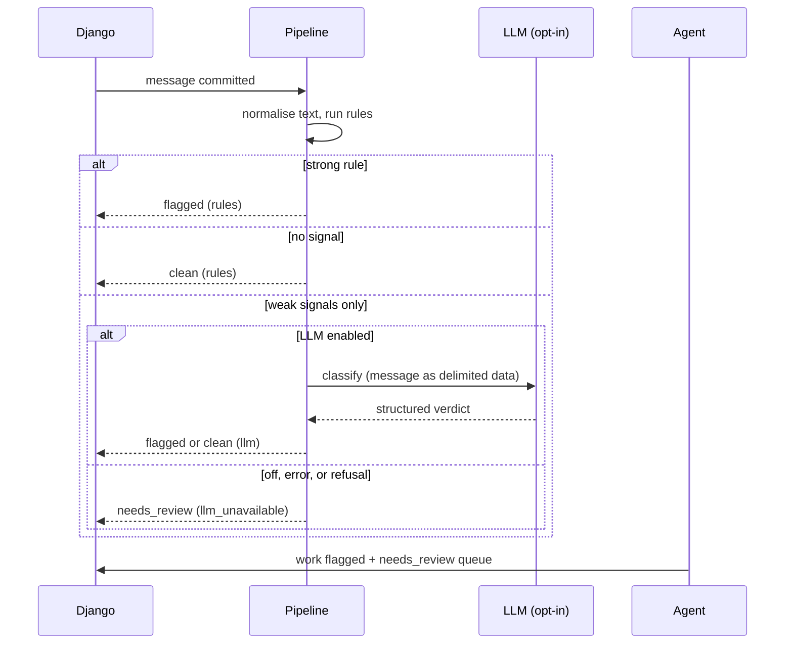
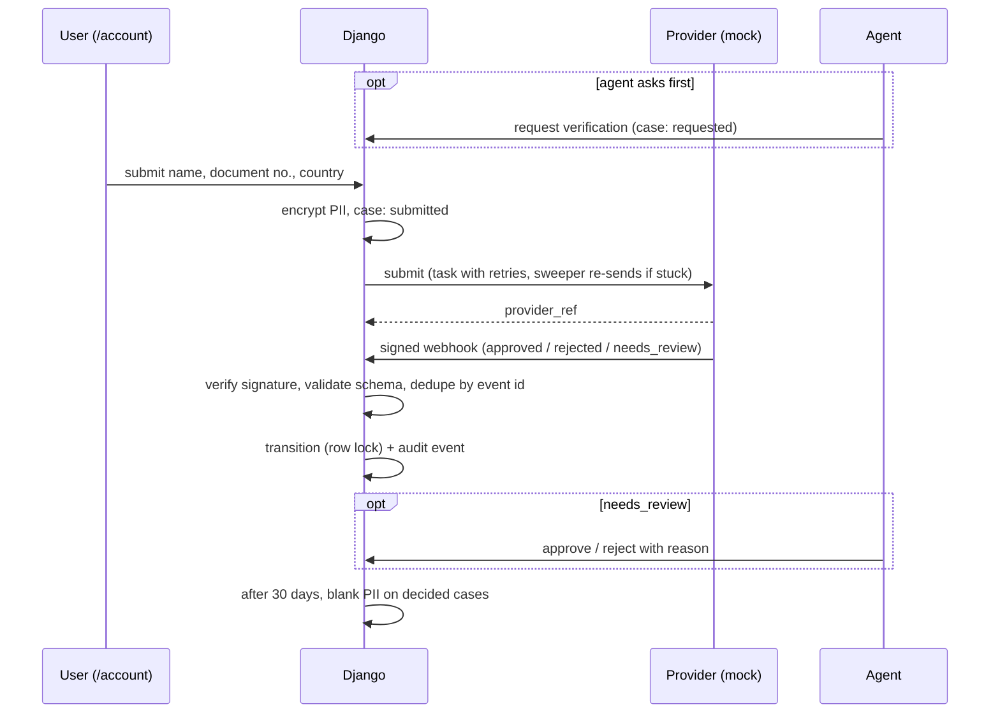

# PawGuard: Technical Design

| | |
|---|---|
| **Status** | Draft for technical review |
| **Date** | 2026-11-10 |
| **Scope** | The Trust & Safety platform for a fictional pet-sitting marketplace |
| **Decisions** | Individual choices and their trade-offs are in the [ADRs](adr/README.md); this document is the system as a whole |

## 1. Summary

PawGuard helps a pet-sitting marketplace keep its users safe. It does three things:

1. **Scores every booking** for fraud risk (0-100) with explainable reason codes.
2. **Moderates chat messages** for scams and attempts to move payment off the platform.
3. **Verifies identity** through an external provider, with a human fallback.

Agents work the resulting queues in a **review console**. The central design rule is that the
system *recommends* and humans *decide*: nothing is enforced automatically, and every agent action
is audited ([ADR 0007](adr/0007-humans-decide-everything-audited.md)).

It is a modular Django monolith with a React + TypeScript front end, Redis, and Celery
([ADR 0001](adr/0001-modular-monolith.md)). It runs end to end locally with a mock verification
provider. It has not been deployed or load tested.

## 2. Goals and non-goals

**Goals**

- Explainable detection: an agent can always see *why* something was flagged.
- Safe to ship imperfect detectors: a wrong flag costs review time, not a customer.
- Tunable without a deploy: thresholds and rule modes live in the database, with a shadow mode.
- Resilient: an outage of Redis, the broker, the LLM, or the provider degrades service but does
  not lose bookings, messages, or verification requests.
- Observable: backlog, flag rates, and failures are visible and alertable.
- Privacy by design for identity data.

**Non-goals (for now)**

- Automatic enforcement (suspending, blocking, cancelling).
- A real verification vendor, payments, a real booking or messaging product.
- Machine-learning models. There is no labelled data yet; review outcomes will become it.
- Multi-region, high availability, or a measured scale target.
- Sign-up, password reset, or MFA.

## 3. Users and roles

| Actor | What they do |
|---|---|
| **Agent** (`role=agent`) | Works the risk, message, and verification queues; suspends or reinstates users; requests verification. Console at `/`. |
| **Owner / Sitter** | Books and chats (not built; the marketplace is simulated), and submits identity details at `/account`. |
| **Provider** | External system that decides verification and reports by signed webhook. Mocked. |
| **Operator** | Runs the system; uses the dashboard and alerts. |

## 4. Requirements and how they are met

| Requirement | How | Where |
|---|---|---|
| Score each booking with reasons | Rules in the DB, additive points, reason codes per hit | [ADR 0002](adr/0002-database-rules-with-shadow-mode.md) |
| Roll out new rules safely | `off` / `shadow` / `active` modes | ADR 0002 |
| Velocity detection | Redis sliding windows, DB fallback | [ADR 0004](adr/0004-redis-sliding-windows-db-fallback.md) |
| Never lose a booking to a scoring problem | Score after commit; failures logged, not raised | [ADR 0003](adr/0003-inline-scoring-celery-opt-in.md) |
| Detect off-platform payment and scams | Rules, then LLM for ambiguous only | [ADR 0005](adr/0005-two-stage-message-moderation.md) |
| Know the detectors are any good | Labelled dataset plus a CI gate | [ADR 0006](adr/0006-eval-harness-and-ci-gate.md) |
| Humans in control, accountable | Review queues, reasons required, audit log | ADR 0007 |
| Trustworthy identity results | Signed, idempotent, contract-checked webhooks | [ADR 0008](adr/0008-verification-provider-webhooks.md) |
| Protect identity data | Encrypted at rest, masked, purged | [ADR 0009](adr/0009-pii-encryption-and-retention.md) |
| Secure staff and user login | Sessions, CSRF, lockout, separate doors | [ADR 0010](adr/0010-session-auth-csrf-lockout.md) |
| Know when it breaks | Metrics, traces, JSON logs, alerts as code | [ADR 0011](adr/0011-observability-as-code.md) |

## 5. Architecture

**Components**

| App | Responsibility |
|---|---|
| `accounts` | `User` (role, status, country, phone, signup IP); end-user auth endpoints |
| `bookings` | `Booking`, with database constraints (valid dates, positive amount, owner is not the sitter) |
| `risk` | `Rule`, `RiskAssessment`, `RuleHit`; evaluators, engine, Redis windows, Celery tasks |
| `moderation` | `Message`, `ModerationResult`; rule stage, LLM stage, pipeline, evaluation harness |
| `verification` | `VerificationCase` state machine, signed webhook, provider boundary, encrypted PII, sweeper, retention |
| `console` | The agent API: queues, review actions, user search, audit, auth |
| `core` | `AuditLog`, shared login code, permissions, metrics, request-id middleware, JSON logging, tracing |
| `frontend/` | Vite + React + TypeScript; agent console and the `/account` app in one bundle |

## 6. Data model

Notes:

- `WebhookEvent` (processed provider event ids, for idempotency) has no foreign key; events are
  matched to a case by `provider_ref` value.
- `RiskAssessment` and `ModerationResult` carry the review state (`pending` / `cleared` /
  `confirmed`, who, when, note).
- `VerificationCase` holds the only PII in the system, encrypted (`full_name`, `document_number`).
- `AuditLog` and `VerificationEvent` are append-only by convention.
- Risk attaches to the booking *owner*; the console also surfaces risk on bookings a user received as
  a sitter, so a sitter linked to a ring is visible on their own page.

## 7. Key flows

### 7.1 A booking is created and scored

### 7.2 A message is moderated

### 7.3 Identity verification

## 8. API surface

| Area | Endpoints |
|---|---|
| Agent console (`role=agent`) | `/api/console/assessments/` (+ `<id>/review/`), `messages/` (+ review), `verifications/` (+ `approve`, `reject`), `users/` (+ `suspend`, `reinstate`, `request-verification`), `audit/` |
| Agent auth | `/api/console/auth/{csrf,login,logout,me}/` |
| User auth | `/api/account/auth/{csrf,login,logout,me}/` |
| Verification (user) | `GET/POST /api/verification/me/` (status; submit) |
| Verification (provider) | `POST /api/verification/webhook/` (HMAC-signed) |
| Ops | `GET /health/`, `GET /metrics/` (bearer token, or DEBUG only) |

List endpoints are paginated and filterable. Destructive actions require a reason; re-reviewing
returns `409`.

## 9. Security and privacy

| Threat | Mitigation | Residual risk |
|---|---|---|
| Forged or replayed provider webhook | HMAC-SHA256 over `timestamp.body`, 5-minute window, constant-time compare, fails closed with no secret | Single shared secret, no rotation |
| Webhook with a wrong shape | JSON Schema contract, rejected with 400 even when signed | Shape only, not behaviour |
| Duplicate or reordered webhooks | Unique event id; illegal transitions acknowledged and ignored | Event table is never pruned |
| Credential stuffing / brute force | Per-IP throttle plus per (door, username, IP) lockout; no account enumeration | No global per-username cap; no MFA |
| Session theft / CSRF | Cookie sessions, CSRF double-submit, app-specific cookie names | Needs same-site or careful CORS |
| Privilege confusion | Role-checked on every endpoint; separate login doors; agents cannot be targeted by console actions | One agent role, no four-eyes |
| Data breach of the database | PII encrypted (Fernet); never returned to users; masked for agents | Key lives in the app environment; no KMS |
| Retaining identity data too long | Daily purge of decided cases after 30 days | Abandoned cases are never purged |
| Prompt injection via a chat message | Message passed as delimited data; structured output; LLM cannot override strong rules or clear no-signal messages | Weak-signal messages rely on the model's judgement |
| Malicious or noisy rule edits | Rules are database rows with modes | Admin edits are not audited |
| Scrape of operational data | `/metrics/` needs a token outside DEBUG | None identified |

## 10. Reliability and failure modes

| If this fails... | ...then | Detected by |
|---|---|---|
| Redis | Velocity counts fall back to the database; login lockout falls back to a per-process cache | Warning logs; fewer Redis-backed results |
| Celery broker | Enqueue fails, work runs inline | `Could not enqueue...` log |
| Celery worker | Async scoring and sends wait; sweeper re-sends stuck verifications | Stuck-submission gauge and alert |
| LLM / API | Ambiguous messages go to humans as `needs_review` | `pawguard_llm_calls_total{outcome}`; moderation by stage |
| Verification provider down | Case stays `submitted`; sweeper re-sends every 5 minutes | Stuck-submission alert (over 15 minutes) |
| Scoring raises | Booking is saved, error logged, no assessment | Log line only (**gap:** no sweeper) |
| Process dies after commit, before dispatch | Work item lost | Not detected (**gap:** in-memory `on_commit`) |
| Agents fall behind | Flagged items wait | Queue-age alert (over 1 hour) |
| Webhook secret wrong | All provider events rejected | Bad-signature alert |

## 11. Performance and capacity

**Measured**, on a development laptop with SQLite, a local Redis, and 17 seeded bookings. This is a
micro-benchmark, not a load test:

| Operation | Result |
|---|---|
| `score_booking` with the Redis window | mean 1.06 ms, p95 1.36 ms (170 runs) |
| `score_booking` with the database fallback | mean 0.73 ms, p95 1.03 ms (170 runs) |
| Moderation rules stage (46-message dataset) | about 6,450 messages/s, 0.155 ms each |

The Redis path is slightly *slower* than the database count here. That is expected with tiny tables
and a local database, and it is why ADR 0004 justifies Redis by scale and by signals with no
database row, not by present speed.

**Not measured:** behaviour under concurrency, on Postgres, with realistic data volumes, with the
LLM stage on (a network call, which will dominate any message that reaches it), or through Celery.

**Reasoning, not measurement:** scoring is a handful of indexed queries per booking, so it should
not be the first bottleneck. The likely first limits are the LLM stage for ambiguous messages, the
per-scrape database queries behind the backlog gauges, and human review throughput.

## 12. Observability

Metrics, JSON logs with request and trace ids, OpenTelemetry traces, an 18-panel Grafana dashboard,
and provisioned alerts (queue older than 1 hour, webhook signature failures, stuck verification
submissions) are in `observability/`. See [ADR 0011](adr/0011-observability-as-code.md). Known
limit: the metrics registry is per process, so Celery-worker events are not visible.

## 13. Testing

187 backend tests plus lint and type checks on the front end.

| Kind | What it covers |
|---|---|
| Unit | Rules, signature verification, state machine, scoring maths, encryption and key rotation |
| Contract | Provider webhook JSON Schema, in both directions, plus example payloads |
| Idempotency and failure | Duplicate webhooks, out-of-order events, stuck submissions, Redis and broker outages, LLM errors and refusals |
| Evaluation gate | Moderation precision/recall floors on a labelled dataset |
| LLM stage | Request shape and parsing against a mocked HTTP transport (never the real API) |
| API and security | Role separation, CSRF, lockout, masking, audit entries, `409` on repeats |
| Observability | Metrics, JSON logs, spans, and that every dashboard/alert metric exists |
| Documentation | ADRs are indexed and cite code that exists |

**Not covered:** automated browser tests (the UI was checked by hand), front-end unit tests, real
Postgres, the real Anthropic API, a real provider, load, and security testing beyond the unit level.

## 14. Deployment and rollout

*Planned, not built.* A sensible shape:

- Containers for web, Celery worker, and Celery beat from one image; managed Postgres and Redis.
- Secrets from the platform's secret store: `DJANGO_SECRET_KEY`, `FIELD_ENCRYPTION_KEYS`,
  `VERIFICATION_WEBHOOK_SECRET`, `METRICS_TOKEN`, and optionally `ANTHROPIC_API_KEY`.
- A CI pipeline running lint, type checks, the full test suite (**on Postgres**), the contract and
  eval gates, then a build and a deploy to a demo environment.
- **Detector rollout:** ship new rules in `shadow`, watch hit rates on the dashboard, promote to
  `active`. Keep the LLM stage off until its cost and quality are measured with `eval_moderation --llm`.

## 15. Risks and open questions

| Risk or question | Why it matters |
|---|---|
| Detector quality in the real world is unknown | The eval set is small and written with the rules; numbers are a regression floor |
| No labelled outcomes yet | Needed to calibrate points or train anything; agent decisions are the source |
| Postgres behaviour is untested | Row locking and JSON behaviour differ from SQLite |
| Alert thresholds are guesses | 1 hour and 15 minutes were chosen, not derived from review capacity |
| LLM cost at volume is unknown | Depends on the ambiguous share, which is 22% on a hand-written dataset |
| Agent privilege is all-or-nothing | One role can suspend any non-agent account |

## 16. Status

| Area | State |
|---|---|
| Risk scoring, windows, async option | Built |
| Message moderation and eval harness | Built (LLM stage verified against a mock only) |
| Identity verification, sweeper, retention | Built (mock provider) |
| Agent console and user `/account` screen | Built |
| Observability | Built; the Docker stack was run by the author, alerts not load tested |
| ADRs | Written |
| CI/CD and a live demo | **Not built** |
| Backtesting harness, audit of rule edits, MFA, sign-up | **Not built** |

## 17. Next steps

1. CI/CD: lint, types, tests on Postgres, contract and eval gates, front-end build, deploy a demo.
2. Close the cheap gaps: audit rule edits, sweep unscored bookings, purge abandoned verifications.
3. Backtesting: replay historical bookings against a candidate rule and report the diff.
4. Run the LLM evaluation for real and choose a model on cost and quality.

## 18. Questions for reviewers

1. Is "recommend only, never enforce" the right line, or should the most extreme cases auto-hold?
2. Is scoring *after* commit acceptable, given that `block` can therefore only flag?
3. Would you accept a JSON Schema contract now and defer Pact until a real provider exists?
4. Is the moderation blind spot (messages with no trigger are never LLM-checked) tolerable, or
   should a sample of "clean" messages be sent to the LLM?
5. What would you instrument or alert on that is missing?
6. Anything in the failure-modes table you would rank as more dangerous than listed?

## Appendix: glossary

- **Shadow rule:** evaluated and recorded but contributes nothing to the score.
- **Strong / weak rule:** a strong match flags a message by itself; weak matches only escalate it.
- **`needs_review`:** ambiguous and not settled automatically; a human decides.
- **Sweeper:** a periodic task that retries work that got stuck.
- **As-of evaluation:** computing a signal as it would have been at a past moment, so replays agree.
